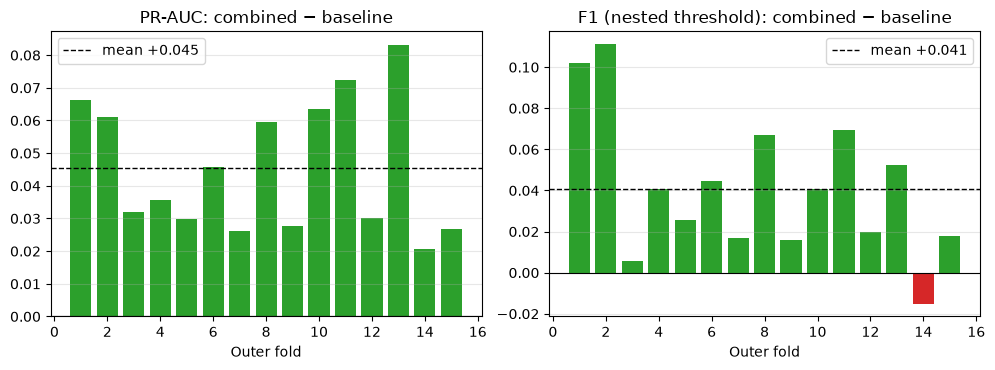
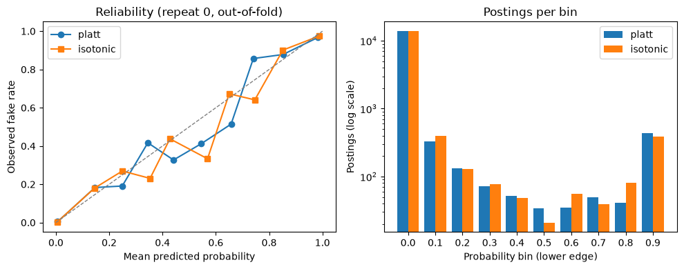

# Fake Job Posting Detection — Experiment Progress and Next Steps

SE3513 · Group FBA

This working document records the comparisons completed so far, the evidence behind the current model choice and the checks another contributor can pick up.

## Research question and finding

Can a classifier flag fraudulent job advertisements for review without overwhelming reviewers with legitimate postings? On repeated grouped validation, a class-weighted linear SVM with word and character TF-IDF achieved mean average precision (AP) of **0.871** and fake-class F1 of **0.789**. Company profiles contributed substantially to the result. Removing them reduced fake-class recall from **75.2% to 60.1%**. These measurements describe development-set performance.

## Data and evaluation design

The dataset contains 17,880 advertisements, including 866 labeled fraudulent (4.84%). Predicting “real” for every posting would yield 95.16% accuracy and detect zero fraudulent ads. We therefore used AP to evaluate the ordering of postings for review and reported fake-class precision, recall and F1 at a chosen decision threshold. Precision measures how often an alert is correct. Recall measures the fraction of fraudulent postings flagged. [Dataset](https://www.kaggle.com/datasets/shivamb/real-or-fake-fake-jobposting-prediction)

We removed exact duplicates after excluding the job identifier and dropped records without a description, leaving 17,598 postings. We grouped similar descriptions before splitting, so copies of a recognizable template could not cross a split when they belonged to the same group. The grouped assignment produced 11,850 training, 3,151 validation and 2,597 test postings. The training and validation sets together formed the 15,001-posting development pool, with 724 fake postings. The test set contained 131 fake postings. [Split implementation](../fakejob/data.py)

For model development we ran five grouped folds three times. In each outer training fold, three inner folds provided scores for choosing the threshold that maximized fake-class F1. Vocabulary and model fitting used training-fold data. Class weighting increased the training penalty for errors on the rare class. For feature and model extensions, the project required positive mean AP gain and improvement in at least 12 of the 15 paired folds. These repeated folds share postings across repeats. [Evaluation notebook](../evaluation_framework.ipynb)

## From the original classifiers to the selected model

The original proposal named three classifiers. On the initial grouped validation split, logistic regression caught 92 of 128 fake ads with 24 false alarms. Multinomial Naive Bayes caught 94 with 259 false alarms. Linear SVM caught 95 with 14 false alarms. This trade-off supported using the SVM as the reference for feature experiments. [Initial comparison](../fake_job_detection.ipynb)

| Repeated grouped validation | Mean AP | Mean fake F1 |
|---|---:|---:|
| Reference SVM | 0.825 | 0.748 |
| Selected word and character SVM | **0.871** | **0.789** |
| Selected SVM with sentence embeddings | 0.863 | 0.778 |
| LightGBM stacking | 0.867 | 0.789 |

The selected SVM uses the title, company profile and description, plus employment type, required experience, telecommuting and company-logo indicators. Word pairs capture short phrases. Character sequences of three to five characters capture recurring fragments. Combining these with sublinear word frequencies improved AP in all 15 paired folds. Repeating the comparison with a fresh split seed also favored the selected model in all 15 folds. Sentence embeddings and stacking failed to improve mean AP. [Feature results](../results/step2_overview.csv) · [Robustness checks](../robustness_checks.ipynb) · [Model extensions](../results/step3_overview.csv)

*Figure 1. Each bar compares the two SVMs on the same fold. Average precision improved on every fold, while F1 improved on 14 of 15.*

We selected Platt calibration to translate SVM scores into estimated fraud probabilities. Its mean Brier score was 0.0141 and its mean expected calibration error was 0.0086. The diagram uses out-of-fold predictions from the first repeat. Bins with few examples give less precise estimates of the observed fraud rate. [Calibration results](../results/step3_step2_baseline_folds.csv)

*Figure 2. The diagonal shows where predicted probability equals the observed fake rate. The accompanying counts show how many postings support each point.*

## How much do company profiles contribute?

“Below link” appeared in 35 fake development postings and one real posting. Several highly weighted phrases overlapped in the same application instruction. Their coefficients describe associations in this dataset. To test how much the model relied on company information, we repeated grouped evaluation after changing the inputs. [Interpretation notebook](../interpretation.ipynb)

| Development input | Mean AP | Fake precision | Fake recall | Fake F1 |
|---|---:|---:|---:|---:|
| Original | 0.871 | 0.834 | 0.752 | 0.789 |
| Recognized company names masked | 0.871 | 0.821 | 0.757 | 0.786 |
| Entire company profile removed | 0.723 | 0.734 | 0.601 | 0.656 |

Removing profiles led to 99, 113 and 116 additional missed fake postings in the three repeats. Each repeat covers the same 724 fake postings. Masking recognizable names changed 1,171 postings, including only 37 fake postings. Its small effect leaves open how much the model relies on unrecognized names or employer-specific wording. [Profile removal](../results/interpretation_without_profile_folds.csv) · [Name masking](../results/interpretation_masked_names_folds.csv)

## Which development postings did the selected SVM misclassify?

We reconstructed repeat 0 of the Step 2 grouped evaluation. Each of the 15,001 postings received one prediction from a model trained on other description groups, with its fold's original development threshold. AP, ROC AUC, precision, recall and F1 matched the five saved fold records. The counts below pool postings across these five folds. A profile is empty when its original value is missing or contains only whitespace. [Per-posting predictions](../results/step2_development_predictions_repeat0.csv) · [Executable analysis](../interpretation.ipynb)

| Original company profile | Real | Fake | Fake detected | Fake missed | Fake recall | False alarms | False alarms / real |
|---|---:|---:|---:|---:|---:|---:|---:|
| Empty | 2,314 | 484 | 333 | 151 | 68.80% | 83 | 3.59% |
| Filled | 11,963 | 240 | 212 | 28 | 88.33% | 7 | 0.06% |
| All | 14,277 | 724 | 545 | 179 | 75.28% | 90 | 0.63% |

Recall was 19.53 percentage points lower among postings with empty profiles. This group contained 151 of 179 misses and 83 of 90 false alarms. These are naturally different groups of postings. Their error-rate gap cannot establish how a particular posting's prediction would change if its profile were filled in.

**Reading the mistakes.** We selected the middle-ranked error by signed distance from its fold threshold in each profile/error pair. The descriptions below illustrate what reviewers would see. They do not identify the cause of an individual prediction.

| Profile | Error | Job ID and title | Detail from the posting |
|---|---|---|---|
| Empty | Missed fake | 8028 · Well Test Operator | A detailed account of assembling, maintaining and loading well-testing equipment accompanied a fraudulent label. |
| Filled | Missed fake | 17686 · Customer Service Agent | The profile describes a business-services provider and the role lists call handling and complaint resolution. Both fields contain conventional job language. |
| Empty | False alarm | 4657 · Call Center Manager | The description names a healthcare employer, identifies its Nashville office and lists supervisory duties despite the empty profile field. |
| Filled | False alarm | 4673 · Operations/Admin Supervisor | The real-estate posting combines an urgent title and home working with specific duties such as visiting tenants and arranging inspections. |

## DistilBERT pilot

We fine-tuned the last DistilBERT block and classification head for one epoch, using short text inputs and a class-weighted loss. Both classifiers used the same training rows within each run and chose thresholds on a separate 600-posting subset. The evaluation subset contained 483 development postings, including 47 fake. The SVM also used its structured inputs. These single-split results use a different protocol from the repeated-validation table. [Small pilot](../results/step4_distilbert_pilot.csv) · [Larger pilot](../results/step4_distilbert_moderate.csv)

| Model and training size | Fake ads detected / 47 | False alarms | Fake F1 |
|---|---:|---:|---:|
| DistilBERT, 1,144 postings | 11 | 37 | 0.232 |
| DistilBERT, 4,675 postings | 20 | 31 | 0.408 |
| SVM, 1,144 postings | 39 | 6 | 0.848 |
| SVM, 4,675 postings | 44 | 15 | 0.830 |

The larger subset provided 213 fraudulent training examples, up from 33. DistilBERT improved, but the SVM detected more fraudulent postings and produced fewer false alarms in both comparisons. Limited input length, partial fine-tuning and the small evaluation sample restrict conclusions about transformer models more broadly.

## Existing test evidence for the reference model

The saved **reference SVM** detected 98 of 131 fraudulent test postings, missed 33 and produced 16 false alarms among 2,466 real postings. Its accuracy was 98.1%, ROC AUC was 0.973 and fake-class F1 was 0.800 (95% group-bootstrap interval 0.701–0.869). A clean-environment rerun reproduced the reference test results. [Reference test estimates and intervals](../results/step1_reference_svm_test_ci.csv)

## Early test evaluation of the selected SVM (withdrawn)

Commit `c70c1b4` locked the selected Step 2 SVM (raw threshold −0.210 from 5-fold grouped out-of-fold development scores, seed 0) and evaluated it once on the test split. It detected 109 of 131 fraudulent postings, missed 22 and produced 11 false alarms among 2,466 real postings: AP 0.918 (95% group-bootstrap interval 0.849–0.961), ROC AUC 0.982, fake precision 0.908, recall 0.832 and F1 0.869 (0.796–0.923). The lock was later reproduced exactly from the project code (same threshold, identical test predictions).

The commit was reverted because development was not finished. The result is recorded here so that it is not lost: later changes are judged only on development cross-validation with rules fixed in advance, the test split is not evaluated again until the final model is locked, and the report states that this early evaluation took place. The files remain available in the history (`git show c70c1b4`).

## Where to continue

| Priority | Task | Evidence to add here |
|---|---|---|
| Before delivery | Lock the configuration. Use grouped out-of-fold development scores to choose the raw SVM threshold and fit the Platt calibrator. Fit the selected pipeline on the development pool and save the fitted objects, threshold and library version together. | In a fresh Python process, compare scores, probabilities and labels before and after reload on the same postings. Include a missing profile and a previously unseen category. Record the artifact path and the results. |
| After locking the model | Evaluate the saved model once on the fixed test split. Keep the threshold and features fixed when examining the results. | Add the confusion matrix, AP, ROC AUC, fake precision, recall and F1 with group-bootstrap uncertainty. Earlier experiments already examined this test split; transfer to new employers or platforms remains an open question. |

For each new result, link the notebook or CSV and identify the model, split and threshold policy. Keep single-split pilot results in their own comparison table.
